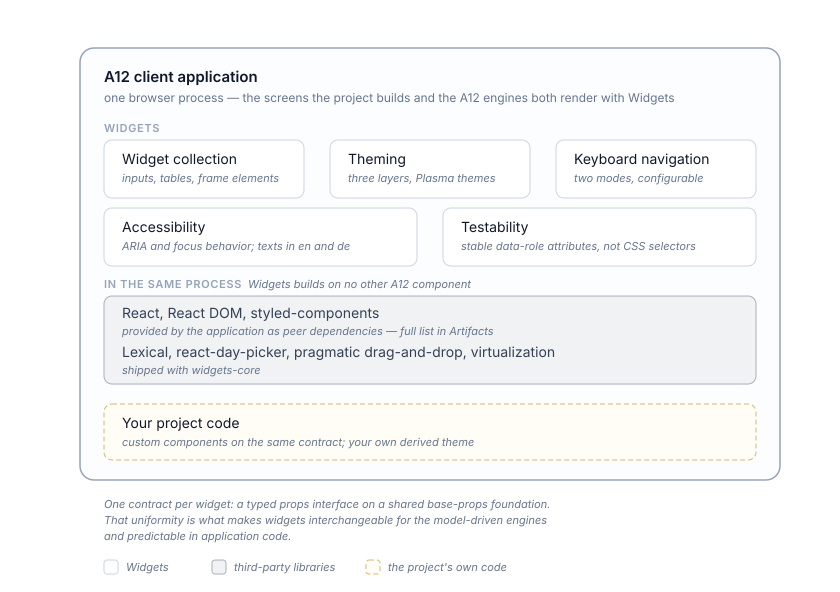

////
SPDX-License-Identifier: EUPL-1.2 OR LicenseRef-commercial
Copyright (c) 2012-2026 mgm technology partners GmbH
Dual License
This source file is part of the mgm A12 Platform and available under a choice of two different licenses:
1. Open-Source License - EUPL v1.2
You may redistribute and/or modify this file under the terms of the European Union Public License, version 1.2 - see https://eupl.eu/.
2. Commercial License
Alternatively, you may obtain a commercial license from mgm technology partners GmbH, that permits use of this software under different terms (including support and maintenance services).

Please contact a12-license@mgm-tp.com for more information.

You must select and comply with exactly one of the above license options.

Warranty Disclaimer (applies to either option)
THIS SOFTWARE IS PROVIDED "AS IS" AND WITHOUT WARRANTY OF ANY KIND, WHETHER EXPRESS OR IMPLIED, INCLUDING BUT NOT LIMITED TO THE WARRANTIES OF MERCHANTABILITY, FITNESS FOR A PARTICULAR PURPOSE AND NON-INFRINGEMENT, EXCEPT WHERE SUCH DISCLAIMERS ARE HELD TO BE LEGALLY INVALID. SEE THE RESPECTIVE LICENSE TEXT FOR DETAILS.
////
= Introduction

// Source formatting: one sentence per line (semantic line breaks) — render-neutral, diff-friendly.

[#functionality]
== Functionality

Widgets is the user-interface component library of the A12 platform:
ready-made React components — from inputs and tables to application-frame building blocks — with consistent theming, keyboard navigation, and accessibility behavior.
It is the visual foundation of every A12 client application:
the model-driven client engines render their forms, tables, and trees with these widgets, and application teams use the same widgets to build custom screens that look and behave consistently with the generated ones.
The widgets support business applications on desktop, tablet, and smartphone, with keyboard, mouse, and touch input.

Widgets also carries the theming of Plasma, A12's design and interaction concept:
applications select or derive a theme, and both the built-in widgets and custom components render accordingly.

Widgets does not render model-driven forms, tables, or trees as such — the client engines (Form Engine, Overview Engine, Tree Engine) do that on top of Widgets — and it does not serve applications outside the React ecosystem, which it requires as a peer dependency.
Custom form widgets are built with Widgets but registered in the Form Engine.

[#architecture]
== Architecture

Widgets is a foundation library:
it builds on no other A12 component, only on the React ecosystem that the consuming application provides as peer dependencies (see Artifacts).
Those third-party libraries, the widgets themselves, and any component a project adds all run in the browser process of the client application.

.Widgets overview

Every widget follows the same component contract:
a React component with a typed props interface built on a shared base-props foundation, its own theme configuration, and stable `data-role` attributes intended for test selection instead of fragile CSS selectors.
This uniformity is what makes widgets interchangeable for the model-driven engines and predictable for application code.

Theming follows a three-layer architecture — application, semantic, and widget level — configured through the styled-components theme provider;
projects select a shipped Plasma theme or derive their own.

Interaction and accessibility behavior is provided as shipped and configurable where applications differ.
Widgets carry semantic markup, ARIA attributes, and focus management, and they ship their screen-reader texts in English and German, which an application replaces through the accessibility language context.
Keyboard navigation offers two modes — Tab and arrow keys, or arrow keys only with Tab moving on to the next widget — configurable for the application as a whole and per widget.
An application wraps its component tree in `WidgetsRoot`, which mounts widget portals inside the React root instead of the document body and keeps the tree resilient to DOM changes made by in-browser translation tools.

The extension surfaces reach from overriding a single widget's theme configuration to swapping out a table's rendering component by component through the component renderers of the table widgets and the slots of the data table;
the accessibility texts and the keyboard-navigation mode are configured the same way.
The interactive link:{showcase-base-url}#/[Widget Showcase,role="external",window="_blank"] documents each widget with its configuration options and carries the technical theming and accessibility documentation.

[#artifacts]
== Artifacts

The package a project declares in its build — not the full set of published modules (npm scope `@com.mgmtp.a12.widgets`, published to the mgm Artifactory npm registry):

[cols="2,3"]
|===
| Artifact | Purpose

| `widgets-core`
| The widget collection.
|===

`widgets-core` declares its rendering stack as peer dependencies, provided by the consuming application:
React, React DOM, react-dnd, and styled-components.
It is imported from its root entry point; pre-release components are imported from the separate `experimental` entry point, and the optional stylesheets for base styles and for the rich-text editor from `styles/`.

[#technologies]
== Technologies

What a project provides, as peer dependencies:
React and React DOM, and styled-components for styling and theming — the complete list is in Artifacts.

What ships with the library:
Lexical for the rich-text editor, react-day-picker for date selection, the pragmatic drag-and-drop packages for the drag-and-drop interactions of the data table and the tree view, and virtualized rendering for large data sets.
The complete third-party set travels with the package as `THIRD_PARTY_NOTICES`.

The library targets the last two versions of Chrome, Edge, Firefox — plus Firefox ESR — Safari, iOS Safari, and Chrome for Android, declared as the package's `browserslist`.

[#terminology]
== Terminology

[cols="1,3"]
|===
| Term | Meaning

| Widget
| A ready-made React component of the library — input, table, navigation, or application-frame element — themed and accessible out of the box.

| Plasma
| A12's design and interaction concept, whose themes ship with Widgets.

| Theme layers
| The three levels of the theming architecture — application, semantic, and widget level — that a theme configures top-down.

| `data-role`
| The stable attribute every widget and every functionally significant element inside it carries, so that consumer tests select elements by role instead of by CSS selector.

| Widget Showcase
| The interactive application presenting the available widgets, their configuration options, and the technical theming and accessibility documentation.
|===
